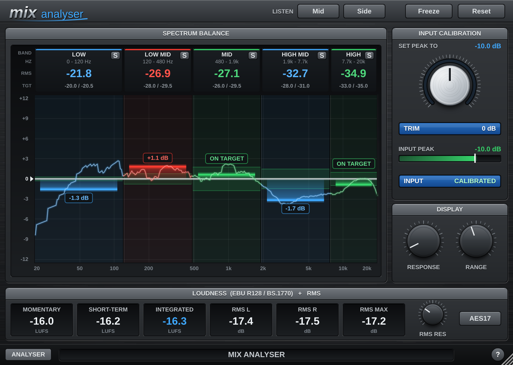

# MIX ANALYSER

A VST3 analyser (Windows) that checks a mix's tonal balance against five target bands.
The GUI uses the same procedurally drawn style as VIRUS DELAY.



## How to use

1. Insert the plugin on your mix bus and play the loudest section.
2. Turn **TRIM** until **INPUT PEAK** reads **-10 dB** and goes green (the LCD below shows how far to move it).
   Only the analysed copy is trimmed; the audio passes through unchanged.
3. Read the bands: **green** = on target, **red** = too much energy, **blue** = too little.
   Bars grow up or down from the target line through the middle.

| Band | Range | Target RMS |
|------|-------|-----------|
| Low | 0 - 120 Hz | -20.0 to -20.5 dB |
| Low Mid | 120 - 480 Hz | -28.0 to -29.5 dB |
| Mid | 480 - 1920 Hz | -26.0 to -29.5 dB |
| High Mid | 1920 - 7680 Hz | -28.0 to -31.0 dB |
| High | 7680 - 20000 Hz | -33.0 to -35.0 dB |

**Response** sets the RMS window (1-30 s), **Range** the dB shown above/below the target line.
**Freeze** holds the readings, **Reset** clears the RMS history. **S** on each band solos it (solo
several to combine), and **Mid** / **Side** (top bar) let you hear the mid or side signal on its own.
Solo and Mid/Side only change what you hear: the meters always measure the full mix. Knobs move in 1.0 steps (drag or
mouse wheel; Shift = 0.1, double-click = default). The window is resizable (70-250 %).

## Loudness and RMS

The **Loudness** panel meters the plugin's input before Trim, so it reads the same as your DAW's meter
on that channel:

* **Momentary / Short-Term / Integrated LUFS**: ITU-R BS.1770-4 / EBU R128, the standard Cubase's
  loudness meter follows (K-weighting; 400 ms, 3 s, and gated integrated with -70 LUFS absolute and
  -10 LU relative gates). Verified against the EBU Tech 3341 test cases.
* **RMS L / R / Max**: unweighted RMS over the **RMS Res** window (1-1000 ms, default 300 ms).
  **AES17** adds +3 dB. Set both to match Cubase's Meter Settings (Resolution, RMS AES17).
* **Reset** clears Integrated and RMS Max.

## Download

Every push to `main` builds the plugin on GitHub Actions. The zip is published to the
`builds` branch: `ANALYSER-VST3-Windows-x64.zip`. Unzip and copy `ANALYSER.vst3` to
`C:\Program Files\Common Files\VST3`.

## Building locally

```
cmake -B build -A x64
cmake --build build --config Release --target Analyser_VST3
```
